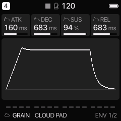
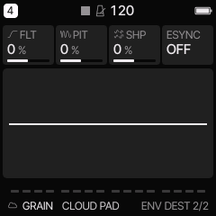
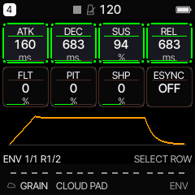
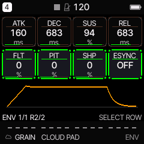

# Single-page GRAIN-only ENV

Base: `574ad82efbe1122e7d07e84faf7ce3ec1d1ca1fe`.
Branch: `feat/coffee-grains-env-one-page`.

## Interaction and compatibility

ENV is one 4-column × 2-row page in the shipping GRAIN-only build:

| Row | K1 | K2 | K3 | K4 |
| --- | --- | --- | --- | --- |
| 1 | ATK | DEC | SUS | REL |
| 2 | FLT | PIT | SHP | ESYNC |

This follows the actual GRAIN EDIT interaction: SELECT selects a **row**, not
an individual cell. All four cells of the active row retain the same persistent
highlight, and K1–K4 edit that row. Either SELECT direction wraps between the
two rows; multi-detent movement is modulo two. Entry, track switching and
another ENV tap select row 1. An ENV tap stays on this page. GLO+SELECT tempo,
BPM LOCK, momentary modifiers and layer priority retain their existing routing.
The saved global SELECT preference is overridden temporarily and never rewritten.
GRAIN EDIT retains its separate three-row/two-page mapping and page gestures.

`page_param_id` remains the authoritative resolver for physical knob editing,
value formatting, momentary edits, motion, MIDI learn and remembered-source-page
parameter locks in STEP. ESYNC retains its existing discrete-setting status: it
is editable and MIDI-learnable, but is not eligible for motion or parameter locks.
The existing transient row byte is reused; there is no
second navigation-state allocation. The legacy ENV DEST descriptor page remains
in `PAGES`, with unchanged order and parameter IDs, but is hidden in shipping
navigation. Stale remembered selections return to ENV; a directly stale hidden
page is normalized to ENV before drawing. Diagnostic multi-engine builds retain
their existing two ENV pages and rendering.

All eight descriptors, ranges, defaults, parameter values, MIDI/editor access,
DSP consumers, preset/project/backup formats and undo infrastructure are unchanged.
No engine code, preset data, sample assets or audio callback was edited.

## Rendering

The page reuses GRAIN EDIT's rounded 57×50 procedural cells, cyan/yellow/magenta/
green track accents, warm coffee-brown outlines, fonts, value formatter and gauges.
The two rows begin at y=28 and y=82. A 240×44 panel at y=140 renders the existing
real ADSR curve in warm gold. Status/row guidance is at y=188; the existing header
and shared HOME coffee-bean sequencer footer remain intact.

`graph_adsr` is reused unchanged: linear attack, exponential decay/release,
actual sustain level and the existing parameter-space time axis. The curve is
scaled vertically, not replaced with a static image. It reads the original ADSR
page IDs even while row 2 is selected. It redraws only when its four raw values
change or a full redraw is required. The spare four entries of the existing
12-cell signature cache hold these four curve values; persistent RAM is unchanged.
ESYNC is included in ENV cell signatures because it changes ADSR time formatting.
Both units and cell pixels update immediately when ESYNC changes. Full panel/cell
clears prevent stale pixels when labels, values or the curve shrink.

No bitmap assets, framebuffer, animation system, allocations or new timer.
Each changed cell blits 2850 pixels; an ADSR edit additionally blits 10560 curve
pixels. No expensive curve work occurs on an unchanged page. These are bounded
rendering operations, not target CPU timing measurements.

## Actual render captures

These are native 240×240 captures from the browser emulator's real RGB565
renderer, converted losslessly to PNG. They are review artifacts, not firmware
assets or replacement test goldens.

| Before: ENV | Before: ENV DEST |
| --- | --- |
|  |  |

| After: row 1 active | After: row 2 active |
| --- | --- |
|  |  |

Reproduce with the existing generated tables and pinned engine dependency:

```sh
python3 tests/env_grid_compare.py --base-tree /path/to/574ad82 --out /tmp/env-compare
```

The runner builds both exact revisions, emits PPM and PNG captures, compares all
non-ENV frames directly and renders real four-track sequencer audio in separate
fresh processes. ENV is intentionally excluded from non-ENV pixel comparison;
no existing goldens are regenerated or weakened. Only the four documented ENV
review captures are added.

## Validation

| Test | Result |
| --- | --- |
| Focused physical ENV grid | 15936 passed / 0 failed |
| Native browser ENV renderer, ASan/UBSan | 3797 assertions, no clipping/bounds/contrast failures |
| Exact-base non-ENV snapshots | 116 frames / 13363200 bytes identical |
| Exact-base real four-track sequencer audio | 524288 PCM bytes identical |
| Full diagnostic UI | 850 passed / 0 failed |
| Editor / project / presets / backup | 172 / 61 / 45 / 103 passed |
| FUN11/FUN10 format | 41146 passed |
| GRAIN-only policy / editor-storage / persistence | 380 / 70 / 24 passed |
| GRAIN four-part audio / CUTOFF-zero | 330 / 2355 passed |
| Existing GRAIN theme / visual grid / navigation grid | 8229 / 1935 / 2329 passed |
| STRETCH descriptor compatibility | 1764 passed |
| Shipping long EDIT integration | 108718 passed, 1388 hold cases |
| Strict long EDIT timing | 1920 passed |
| Focused browser editor policy | 20 passed |
| `git diff --check`, test-runner shell syntax | Pass |

All non-ENV comparisons use the exact requested base. Real sequencer/mixer
renders use master=4096: peak 13962, RMS 1496.355513, 119774 nonzero stereo
samples. All four tracks sound; comparison runs start in fresh processes. The
retained CUTOFF audio fixture also passes all eight type/transition renders,
and the four existing STRETCH audio render runs complete.

The historical native MIDI suite has **134 passing / 15 failing** assertions;
motion has **97 passing / 27 failing**. Both were rerun on the exact base and
fix; the failing assertion names match exactly. No tests or assertions were
removed or weakened. Diagnostic multi-engine mode is used for the full legacy
UI/backend suites; new ENV behavior and policy regressions use shipping mode.
The older navigation grid fixture intentionally uses diagnostic mode to exercise
other engines. The full registered DSP script and broad web suite were not
rerun for this UI-only change.

The new physical tests cover all four tracks and all four saved SELECT modes,
all eight knob targets, inert out-of-range resolver indices, both-direction and
multi-detent wrapping, repeat ENV taps, stale hidden-page recovery, track reset,
GLO+SELECT priority, locks remembered into STEP, motion, MIDI-learn targets,
momentary restoration, project/runtime reload, presets and undo. Curve edits
and ESYNC transitions are compared against forced redraws; the existing HOME
step-symbol strip is compared for note/rest/tie/empty and playhead states.
The existing long-EDIT matrix also covers the new ENV page. Its hold case count
falls by 32 because the second ENV page is intentionally no longer visible.

Rendered UI/DSP sanitizer runs use the repository's existing exclusions for
signed overflow, shift, bounds, object-size and pointer-overflow. ASan and the
remaining UBSan checks remain enabled; these are not full strict-DSP validation.
The retained long-EDIT timing primitive also runs separately with all sanitizer
checks enabled. No sanitizer exclusions were added to production or tests.

## Resources and limitations

Native GCC 14.2, identical `-Os -ffp-contract=off` compilation of
`web/emu/felucca_web.c` (full emulator object):

| Section | Base | Fix | Delta |
| --- | ---: | ---: | ---: |
| text, including read-only constants | 879229 | 879920 | +691 bytes |
| data | 31060 | 31060 | 0 |
| BSS | 1603232 | 1603232 | 0 |

Persistent RAM, engine memory and framebuffer allocation: **unchanged**.
Firmware bitmap cost: **zero**. The four PNG captures are documentation only.
Native compiler stack reports: grid renderer 176 → 208 bytes (+32), ADSR helper
88 → 88 and `ui_input` 208 → 208. These individual native frames do not establish
target worst-case stack usage or call-chain headroom.

Emscripten is unavailable. `sh web/emu/build.sh` stops with:

```text
emu: no emcc (Emscripten)
```

The native browser renderer is tested, but a new WASM binary/browser session
cannot be validated here. The target JieLi toolchain is unavailable; hardware
flash fit and target CPU/stack headroom remain unverified. Native object sizes
are not a target-link estimate or a claim of release readiness.

## Changed files

- `firmware/src/params.c`: shared UI grid resolver and ENV row mapping only.
- `firmware/src/ui.c`: ENV visibility, shared row entry/track reset.
- `firmware/src/ui_input.c`: reuse SELECT grid routing with per-page row count.
- `firmware/src/grain_edit_grid.c`: existing cell renderer extended for ENV/curve.
- `firmware/src/ui_draw.c`: shared rendering/footer routing and stale ENV recovery.
- `firmware/src/ui_help.c`: accurate ENV SELECT/K1–K4 hint.
- `tests/env_grid_test.c`: physical editing, navigation, automation and persistence.
- `web/emu/env_grid_visuals_test.c`: live values, clipping/bounds, redraws/captures.
- `tests/env_grid_compare.py`: exact-base screenshots/non-ENV/audio comparison.
- `tests/run_grain_only.sh`: focused suite and optional base comparison registration.
- This report and four native-resolution ENV capture PNGs.
