# GLO visual theme

Base: `c17e37eedeed50edf46dff552f52ec56df530a44`.
Branch: `feat/coffee-grains-glo-theme`.

## Two distinct interfaces, unchanged interactions

Short GLO still opens SONG; held/double-tapped GLO still uses the existing GLOBAL
CONTROLS layer. No input handler, timer, routing, sequencer, project/preset data,
parameter descriptor, MIDI, audio engine or serialized format was changed.
Diagnostic multi-engine mode retains the old GLO presentation.

Both interfaces now use rounded cards, the existing cyan/yellow/magenta/green
track colors, coffee-brown outlines, dark fills and existing fonts. The palette
constants were moved from the GRAIN renderer into shared UI scope without changing
their values or allocating new state. Other screens retain their exact pixels.

SONG keeps SEC/TRACK/PAT/REPS at the existing coordinates. The exact existing
values feed the new cards; changing the selected arrangement track changes their
accent. The existing timeline, lane grouping, A–D assignments, silent lanes,
pattern-density pictures, ruler, duration/project-name line, + ADD, playback
position and scrolling calculations are untouched. New colored lane badges and
coffee outlines improve separation; the actual selected cell receives a bright
track-colored frame. No decorative panel or scientist consumes arrangement space.

GLOBAL CONTROLS keeps LEVEL 1–4, SOLO, ALL, LEARN, FILL, TAP and the black-key
MUTE controls in their original cells. Notes/sharps remain visible, along with
explicit track numbers. Every LEVEL uses the original `F_DB` formatter, including
OFF at zero, and a gauge based on the original raw ratio. Muted/solo-suppressed
levels remain dim. Active/latched/held cells use bright frames and bottom marks;
external-clock TAP remains dim. ALL/TAP held feedback reads real key state.
Only their two held flags are added to the existing rendering signature, so
irrelevant key edges do not cause extra body redraws.

PLAY/RESTART, OCT-/UNDO, GLO/DONE, locked-layer footer variants, HELP, keyboard
shortcuts, sound undo, project SAVE and all encoder/button combinations keep their
existing code. The status bar and complete footer are pixel-identical to base
for matching states. Rounded cards reuse the existing column cache; no new
persistent animation state, timer, framebuffer or bitmap is introduced. Values
update immediately rather than adding a separate interpolation system.

## Actual 240×240 RGB565 captures

These are lossless native browser-emulator renders, not mockups or firmware
assets. They use actual project slots and current control state.

| State | Exact base | Redesigned |
| --- | --- | --- |
| Empty SONG | 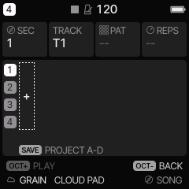 | 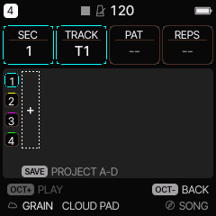 |
| Populated A–D arrangement | 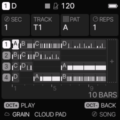 | 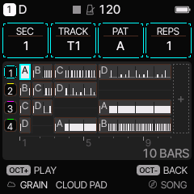 |
| Actual song playhead | 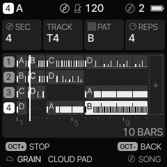 | 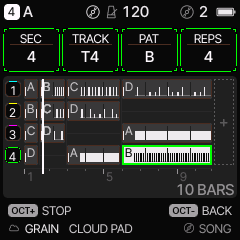 |
| Held GLO, idle controls | 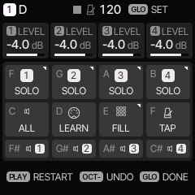 | 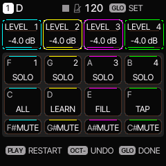 |
| Active SOLO/MUTE/LEARN/FILL/ALL | 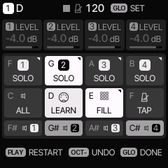 | 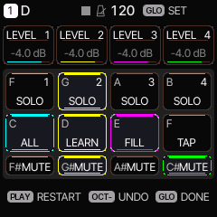 |
| Locked GLO | 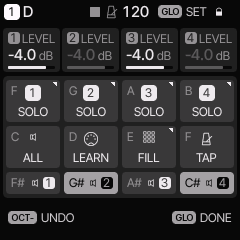 | 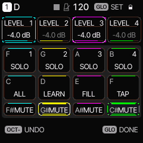 |
| External clock |  | 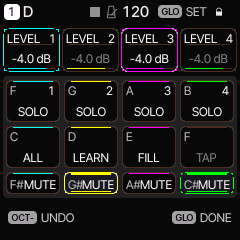 |

Reproduce with existing generated tables and the pinned engine dependency:

```sh
python3 tests/glo_theme_compare.py --base-tree /path/to/c17e37e --out /tmp/glo-theme
```

`GLO_THEME_BASE_TREE` enables the comparison from `tests/run_grain_only.sh`.
No unrelated golden files or existing test assertions were changed.

## Interaction and rendering verification

- **158 interaction assertions** pass on both exact base and fix, across all four
  tracks. The same physical event script produces **172 byte-identical serialized
  state checkpoints** (860688 bytes): song/project state, all parameter/step data,
  arrangement, selected row/track, layer/lock state, solo/fill, transport requests,
  MIDI-learn state and octave.
- Covers short GLO; project A–D save and assignment; section/track/pattern/repeat
  turns; SAVE/sound-undo route; all mutes; ALL; each SOLO held across GLO release;
  LEVEL edits and OCT- restore; LEARN; FILL release; real timed TAP; external TAP;
  PLAY/RESTART; double-tap lock; locked PLAY and DONE.
- During that interaction trace, **44 restored non-GLO frames** match completely;
  **128 GLO states** retain exact header and footer pixels. Only intended GLO
  bodies differ. This verifies restoration after closing the overlay.
- **100 unrelated frames** (11520000 RGB565 bytes) match completely, including
  GRAIN, ENV, LFO, MOD MATRIX, HOME/MIXER/CLOCK and retained descriptor pages.
- **3578 native render assertions** pass. All 128 legal LEVEL values across all
  channels match the original formatter exactly; OFF remains OFF. All 16 MUTE
  masks × 16 SOLO masks are exercised, including LEARN/FILL, clock and held
  ALL/TAP states. Pixel assertions verify actual active/inactive frames.
- Empty, four-section and full-capacity arrangements, all selected tracks/rows,
  A–D/silent assignments, playback and scrolling positions retain correct values.
  Incremental renders match forced redraws; cell text/contrast and blit bounds
  stay inside the native 240×240 surface. Dim states intentionally use lower
  contrast than active controls while remaining readable.
- Four-track real sequencer/mixer output is **524288 PCM bytes identical** to the
  exact base in fresh processes with master=4096. Both renders verify nonzero
  output: peak 13962, RMS 1496.355513, 119774 nonzero stereo samples, step 11.

### Existing regressions

| Suite | Passing assertions |
| --- | ---: |
| Full diagnostic UI/navigation | 850 |
| GRAIN-only policy / editor-storage / persistence | 380 / 70 / 24 |
| Four-track audio / CUTOFF-zero | 330 / 2355 |
| GRAIN grid / theme / visual bounds | 2329 / 8229 / 1935 |
| ENV grid / visual bounds | 15936 / 3794 |
| Editor / project / presets / backup | 172 / 61 / 45 / 103 |
| FUN11/FUN10 format | 41146 |
| STRETCH descriptors | 1764 |
| Long EDIT integration | 98670 (1260 hold cases) |
| Long EDIT timing fixture | 1920 (same integration flags) |

The existing CUTOFF audio fixture's eight personality/transition renders and
four STRETCH audio runs complete. Known MIDI failures remain 134 passing / 15
failing; motion remains 97 passing / 27 failing. Exact-base runs have the same
failing assertion names. No new failures are hidden by changing fixtures.
Legacy multi-engine/backend tests use diagnostic mode; new GLO tests and shipping
policy/visual suites use GRAIN-only mode.

Rendered tests run ASan+UBSan with the repository's historical exclusions for
signed overflow, shift, bounds, object-size and pointer-overflow. No new exclusions
or sanitizer diagnostics. Full numerical DSP and broad web suites were not rerun
for this visual change.

## Native resources

Identical GCC 14.2 `-Os -ffp-contract=off` compilation of the complete native
`web/emu/felucca_web.c` object:

| Section | Exact base | Fix | Delta |
| --- | ---: | ---: | ---: |
| text, including read-only constants | 882359 | 884745 | +2386 bytes |
| data | 31060 | 31060 | 0 |
| BSS | 1603232 | 1603232 | 0 |

Persistent RAM, engine state, framebuffer and firmware bitmap allocation are
unchanged. Native individual stack frames: `draw_column` 288 → 304 bytes;
`graph_song` 592 → 624; new outline helper 72; new overlay-cell helper 128
(existing generic `lcell` is 120); `draw_foot` 336 → 336 and `ui_input` 208 → 208.
These are individual host frames, not target worst-case call-chain stack bounds.
Existing dirty signatures/caches bound redraws to values/state/view changes.

Emscripten and the target JieLi toolchain remain unavailable. Native browser
rendering is tested; a new WASM session and hardware flash fit are unverified.
No target fit, deployment or hardware-readiness claim is made without a target
link. No merge, deploy or flashing.

## Changed files

- `firmware/src/ui_draw.c`: scoped GLO card rendering; existing value/input paths remain.
- `firmware/src/ui_graph.c`: SONG outlines and lane badges only; geometry/math retained.
- `firmware/src/ui_layer.c`: GLO cells and held-state rendering signature only.
- `firmware/src/ui.c`, `firmware/src/grain_edit_grid.c`: relocate unchanged shared colors.
- `tests/glo_theme_test.c`: physical events and state/restoration trace.
- `web/emu/glo_visuals_test.c`: native captures, values, state and bounds sweeps.
- `tests/glo_theme_compare.py`, `tests/run_grain_only.sh`: reproducible validation.
- This report and 14 before/after capture PNGs (documentation only).
