# Single-page LFO and dedicated MOD MATRIX

Base: `9e47723b1a8e87a083eb68e847f6ac780162f9e9`.
Branch: `feat/coffee-grains-lfo-mod-ui`.

## Navigation and retained data

Shipping GRAIN-only mode presents one LFO page. SELECT chooses its active row;
K1–K4 edit that row using the existing shared `page_param_id` resolver. Entry,
another LFO tap and track switching select row 1. SELECT wraps forward/reverse
modulo three. The saved global SELECT preference is never changed. GLO+SELECT,
BPM LOCK, LFO-held momentary edits and other layer priorities retain their routes.
The empty cell resolves to 255 and cannot edit a reserved parameter or produce
motion. GRAIN EDIT and ENV retain their existing maps and navigation.

SCL release opens MOD MATRIX; repeated taps remain on it. K1 still selects one
of four slots with the existing sign-based, clamped movement; K2/K3/K4 edit
that slot's SRC/DST/AMT. The selected slot persists across track changes exactly
as before; the values always belong to the actual selected track.

The old SCL quick layer was an alternate chord/scale entry: hold, double-tap,
key+SCL, knob+SCL and OCT+SCL could open it or edit ROOT/SCALE/CHRD/VOIC. Shipping
mode no longer arms that layer. SCL is now an ordinary page button, like ENV:
its release opens the matrix even after a hold; double taps do not lock the old
layer. Keys and encoders while it is held retain ordinary underlying-page
behavior, rather than hidden scale/chord actions. Other layers/shortcuts remain
unchanged. A stale SCL armed/locked gesture is closed before input processing.
Diagnostic multi-engine builds retain the original LFO/SCL pages and layer.

Descriptor order and raw families in `PAGES` are unchanged. A presentation-only
`page_family` maps MOD to SCL for navigation, remembered pages, page titles and
button indicators. Visibility hides LFO 2, LFO DEST, SCL and CHORD; MOD no longer
belongs to the LFO navigation ring. Hidden/stale pages normalize before input
and drawing: old LFO pages return to the LFO grid, and SCL/CHORD return to MOD.
Stale remembered LFO=MOD and SCL=CHORD selections are rejected by the same map.

Scale/chord parameters are **not neutralized or removed**. Saved values still
affect existing playback according to the unchanged engine and remain available
to the editor/protocol. Existing projects, presets, backups, unknown fields,
undo and GRAIN-only legacy-project rejection policy retain their formats/data.
No DSP, modulation arithmetic, sample data, allocator or engine policy changed.

## Exact parameter mapping

All descriptors, ranges, defaults and formatter behavior are reused unchanged.

| LFO row | K1 | K2 | K3 | K4 |
| --- | --- | --- | --- | --- |
| 1 | RATE (9) | WAVE (10) | PHS (11) | FADE (12) |
| 2 | SYNC (91) | TRIG (92) | POL (93) | empty (255 sentinel) |
| 3 | PIT (13) | FLT (14) | SHP (15) | AMP (16) |

The matrix retains SRC/DST/AMT triples **49–51, 52–54, 55–57, 58–60**. K1 SLOT
is a UI selector, not a new sound parameter. Names use the existing `N_MSRC`
and `mod_dst_name`, including engine-specific destination labels. No source or
destination is renamed or reinterpreted.

The shared resolver feeds physical edits, MIDI learn, momentary operations and
remembered page-relative locks. The SYNC/TRIG/POL row contains only settings
that are already ineligible for motion/locks. A local UI lock-target guard keeps
that remembered row inert rather than falling back to HOME knobs. Their existing
MIDI/editor editability is retained. Matrix lock/motion eligibility is unchanged.

## Procedural layout and dirty redraws

LFO uses the existing track accents, coffee-brown outlines and rounded cells,
compressed to 57×44 at y=28, 75, 122. Live values and units use the existing small
font together, and the active row remains highlighted. The existing real
`graph_lfo` helper is reused unchanged on a 240×32 panel at y=169 with graph
height 30. It retains the existing WAVE/PHS/POL behavior (including the old
deterministic S&H preview); it is not a free-running animation. Only relevant
changes/full redraws regenerate it. There is no row/page instruction strip.

The matrix uses four compact top controls at y=28 and four rounded source →
destination/amount rows at y=82, 111, 140, 169. The real selected slot has a
persistent bright track-colored border. Full clears and per-row redraws prevent
old strings/values from remaining when slots or tracks change. The footer uses
the existing shared coffee-bean sequencer and normal status labels. Its title
is MOD, with no obsolete LFO 4/4 suffix.

Both views reuse the existing 12-entry grid signature cache and row state;
there is no new persistent UI state, image asset, framebuffer, timer or audio
callback work. Matrix row signatures store the three raw values, not lossy
hashes. LFO signatures pack raw values, SYNC and IDs into separate bit fields.

## Native render captures

These are real 240×240 captures of the native browser renderer. The old pages
are kept for comparison; all new rows/slots have their own capture. Matrix
examples use legal values in real track parameter slots, not decorative rows.
PNG files are documentation only and are never linked into firmware.

| Before | Capture |
| --- | --- |
| LFO 1 | 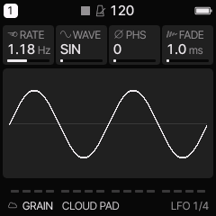 |
| LFO 2 | 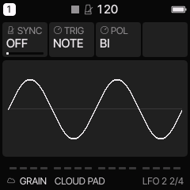 |
| LFO DEST | 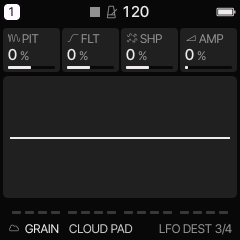 |
| LFO MOD | 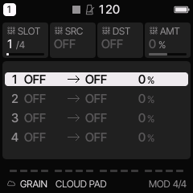 |
| SCL | 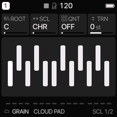 |
| CHORD | 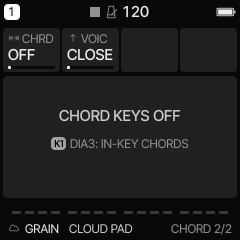 |

| New LFO row 1 | New LFO row 2 | New LFO row 3 |
| --- | --- | --- |
| 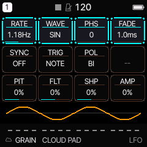 | 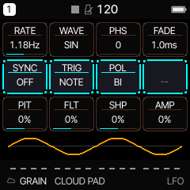 | 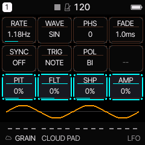 |

| Matrix slot 1 | Matrix slot 2 |
| --- | --- |
| 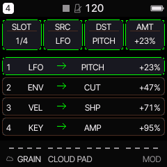 | 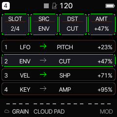 |

| Matrix slot 3 | Matrix slot 4 |
| --- | --- |
| 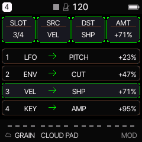 | 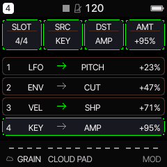 |

Reproduce (existing generated tables and pinned engine dependency required):

```sh
python3 tests/lfo_mod_compare.py --base-tree /path/to/9e47723 --out /tmp/lfo-mod
```

The runner builds base/fix, emits actual native 240×240 RGB565 frames converted
losslessly to PNG, compares unrelated screens directly and renders independent
fresh-process four-track audio. No unrelated golden files are regenerated.
`LFO_MOD_BASE_TREE` enables it from `tests/run_grain_only.sh`.

## Validation

| Check | Result |
| --- | --- |
| New physical LFO/MOD UI, ASan/UBSan | 45195 assertions passed |
| New native visual/value/bounds test | 6364 assertions passed |
| Unrelated-screen exact-base comparison | 96 frames / 11059200 bytes identical |
| Real four-track exact-base audio | 524288 PCM bytes identical |
| Existing modulation suite, base and fix | 39 assertions passed on each |
| Full diagnostic UI | 850 passing / 0 failing |
| Existing GRAIN navigation / theme / visual sweep | 2329 / 8229 / 1935 passed |
| Existing ENV grid / visual sweep | 15936 / 3794 passed |
| GRAIN-only policy / editor-storage / persistence | 380 / 70 / 24 passed |
| Four-part audio / CUTOFF-zero | 330 / 2355 passed |
| Editor / project / presets / backup | 172 / 61 / 45 / 103 passed |
| FUN11/FUN10 project format | 41146 passed |
| STRETCH descriptors | 1764 passed |
| Long EDIT integration | 98670 passed, 1260 hold cases |
| Long EDIT timing fixture | 1920 passed (same integration flags) |
| Browser editor policy | 20 passed |
| Whitespace, shell and Python syntax | Pass |

Known MIDI failures remain 134 passing / 15 failing; motion remains 97 passing /
27 failing. Both were rerun on the exact base and fix; failing assertion names
match. Diagnostic multi-engine builds are used for legacy backend/UI suites;
shipping-mode focused tests verify the new navigation. No existing test or
golden was changed or removed. Existing CUTOFF audio tests complete all eight
personality/transition renders; four existing STRETCH audio renders complete.

The new physical tests cover all four tracks and all four SELECT modes, every
populated cell, inert empty cell, row wrapping, repeated page taps, all matrix
slots, MIDI learn targets, GLO+SELECT with BPM LOCK, key/encoder/OCT combinations,
SCL holds/double taps, hidden/stale pages, motion and remembered-source locks,
project/preset/runtime reload and undo. They also retain long FX/GLO/SEQ/SAVE
behavior to catch switch-routing regressions. SYNC/TRIG/POL do not become locks.

The new visual test sweeps all legal LFO/matrix control values and all tracks,
checks labels, contrast, clipping/blit bounds, selected frames, waveform phase/
polarity/shape changes and incremental-versus-forced redraw identity. It tests
idle redraw suppression. The waveform panel ends before the actual footer at
y=202, avoiding a one-pixel dirty-redraw overlap found during development.

Unrelated comparisons include both GRAIN pages, ENV, HOME/MIXER/CLOCK and every
other retained visible descriptor page, with complete frame byte comparisons.
Actual four-track sequencer/mixer renders use master=4096: peak 13962, RMS
1496.355513, 119774 nonzero stereo samples, sequencer step 11. A silent-buffer
comparison cannot pass this fixture.

Rendered UI/DSP tests use ASan+UBSan with the repository's existing exclusions
for signed overflow, shift, bounds, object-size and pointer-overflow. ASan and
remaining UBSan checks stay enabled; no new exclusions or weakened assertions.
The modulation instruction-counter performance test is explicitly unavailable
on this host, so its cost limit is not a measured hardware result. Full numerical
DSP and broad web suites were not rerun for this UI-only change.

## Native resources / hardware limits

Identical GCC 14.2 `-Os -ffp-contract=off` compilation of the complete native
`web/emu/felucca_web.c` object:

| Native section | Exact base | Fix | Delta |
| --- | ---: | ---: | ---: |
| text, including read-only constants | 879629 | 882317 | +2688 bytes |
| data | 31060 | 31060 | 0 |
| BSS | 1603232 | 1603232 | 0 |

There is no additional persistent RAM, engine state, framebuffer or firmware
bitmap. The existing grid cache/row byte and existing matrix slot selector are
reused. Native individual stack frames: shared grid renderer 192 → 176 bytes,
new matrix renderer 152 bytes, page normalization helper 16 bytes, `ui_input`
208 → 208 bytes, existing waveform helper 72 → 72 bytes. These are compiler
reports for individual host frames, not target call-chain stack bounds.
A changed LFO cell blits 2508 pixels; waveform updates blit 7680 pixels.
Each changed matrix row blits 6084 pixels; selected-value/slot changes also
refresh the four small control panels. Work is bounded and there is no extra
idle animation or audio callback work.

`sh web/emu/build.sh` stops with `emu: no emcc (Emscripten)`. Native browser
renderer tests run, but no fresh WASM/browser session can be claimed. The target
JieLi toolchain is unavailable. Hardware flash fit and target CPU/stack headroom
remain unverified without a successful target link. No merge, deploy or flashing.

## Changed files

- `firmware/src/params.c`: UI-only LFO mapping/effective page family.
- `firmware/src/ui.c`: visible-page navigation, normalization and inert-row lock routing.
- `firmware/src/ui_input.c`: normalize before editing and ordinary SCL page-button routing.
- `firmware/src/ui_layer.c`: suppress shipping SCL scale/chord layer entries.
- `firmware/src/ui_graph.c`: effective-family page title counting only.
- `firmware/src/grain_edit_grid.c`: compact LFO/shared cells, existing waveform, procedural matrix.
- `firmware/src/ui_draw.c`: custom matrix routing and shared footer/cache lifecycle.
- `firmware/src/ui_help.c`: correct LFO row-navigation HELP.
- `tests/lfo_mod_ui_test.c`, `web/emu/lfo_mod_visuals_test.c`: focused navigation/edit/render tests.
- `tests/lfo_mod_compare.py`, `tests/run_grain_only.sh`: reproducible comparison/registration.
- This report and native before/after documentation captures (not firmware assets).
