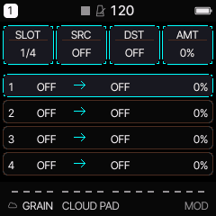
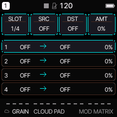

# Dedicated MOD footer label

Base: `004664a95fe20a10caa08419ec8f7f34d595b1b4`.
Branch: `fix/coffee-grains-mod-matrix-label`.

The only production change is a footer-local string override in
`firmware/src/ui_draw.c:draw_foot`: the active dedicated matrix displays
`MOD MATRIX`. `page_title` still returns `MOD`; the screen title, controls,
slot selection, layout and navigation are unchanged.

The existing `AF_S` font, `T_MID` styling, y=19 footer baseline and right-alignment
anchor x=232 are reused. The label participates in the existing footer signature,
so dirty redraws update normally. The existing bounded preset-name renderer
reserves space before the label. Long names keep its existing ellipsis policy;
the new label is never truncated, abbreviated or drawn over the name.

## Actual 240×240 capture

| Exact base | Updated |
| --- | --- |
|  |  |

These lossless captures are documentation only, not firmware bitmap assets.
Reproduce with the existing generated tables and pinned engine dependency:

```sh
python3 tests/mod_label_compare.py --base-tree /path/to/004664a --out /tmp/mod-label
```

`MOD_LABEL_BASE_TREE` also enables this check from `tests/run_grain_only.sh`.
No unrelated goldens are changed.

## Validation

- **72 focused assertions passed** across four tracks and all four matrix slots.
- Full label ink bounds: x=162..232, footer y=22..32 (screen y=224..234),
  with no clipping/ellipsis flags. Its advance remains anchored at x=232.
- Maximum-length preset-name test passes the explicit 12-pixel separation check.
- **100 unrelated frames** (11520000 RGB565 bytes) are byte-identical to base.
- In 16 matrix frames, every pixel outside x=162..231, y=224..233 is identical;
  only the label ink rectangle changes. Preset/engine names, controls, matrix
  rows and step strip match.
- Existing LFO/MOD UI: **45195** assertions passed.
- Existing ENV UI: **15936** assertions passed.
- Existing native LFO/MOD visual sweep: **6364** assertions passed.
- Incremental-versus-forced redraw, 240×240 bounds, whitespace and syntax pass.

The rendered UI suites use ASan+UBSan with the repository's existing exclusions
for signed overflow, shift, bounds, object-size and pointer-overflow. No new
sanitizer exclusions, failures or weakened assertions. Broad DSP, MIDI and motion
suites were not rerun for this one-line footer change.

## Native cost

Identical GCC 14.2 `-Os -ffp-contract=off` native emulator object compilation:

| Section | Base | Fix | Delta |
| --- | ---: | ---: | ---: |
| text, including read-only strings | 882317 | 882359 | +42 bytes |
| data | 31060 | 31060 | 0 |
| BSS | 1603232 | 1603232 | 0 |

No persistent RAM, framebuffer, DSP or firmware asset changes. The native
`draw_foot` stack frame remains 336 bytes. These host measurements do not prove
target flash fit; hardware remains unverified without a successful target link.
No merge, deployment or flashing.

Changed files: `firmware/src/ui_draw.c`, `web/emu/mod_label_test.c`,
`tests/mod_label_compare.py`, `tests/run_grain_only.sh`, this report and its two
native capture PNGs.
