# Remove GRAIN EDIT / ENV grid hints

Base: `5bb8fcc97253c00e1d619b5851164bed95b269b6`.
Branch: `fix/coffee-grains-remove-grid-hints`.

## Change

Removed only the five-line full-redraw text block in
`firmware/src/grain_edit_grid.c:draw_grain_grid`. This removes the page/row
status and `SELECT ROW` instruction from both GRAIN EDIT pages and the single
ENV page. The existing full redraw already fills y=24 up to the sequencer
footer with black before drawing cells/curve, so the freed y=188..199 strip
stays clean without a replacement panel, separator or extra clear operation.
Nothing is moved or resized. Row highlights, cells, live values, ADSR curve,
coffee-bean step strip and bottom track/sound labels are unchanged.

SELECT/K1–K4, page gestures, parameter resolution, MIDI learn, motion/locks,
DSP, serialization and sample assets are untouched. No new state or allocation.
The existing contextual HELP mechanism elsewhere in the footer is unchanged;
this change removes only the dedicated grid status/instruction strip.

## Actual before/after captures

All images are real native 240×240 RGB565 browser-emulator frames, converted
losslessly to PNG. The table shows CH1 for every requested row/page combination.
The test also captures all three other tracks: 32 grid frames per revision.
These PNGs are documentation artifacts, never linked firmware assets.

| State | Exact base | After |
| --- | --- | --- |
| GRAIN 1, row 1 | 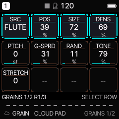 | 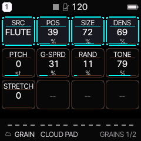 |
| GRAIN 1, row 2 | 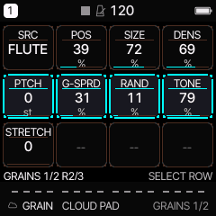 | 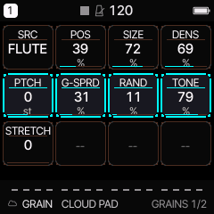 |
| GRAIN 1, row 3 | 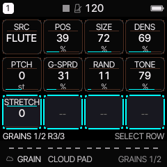 | 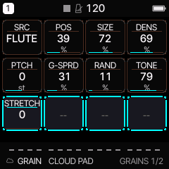 |
| GRAIN 2, row 1 | 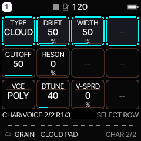 | 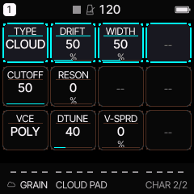 |
| GRAIN 2, row 2 | 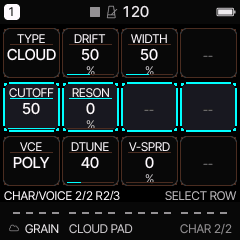 | 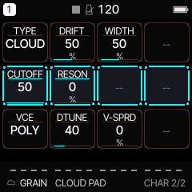 |
| GRAIN 2, row 3 | 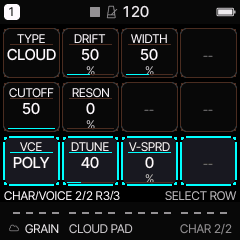 | 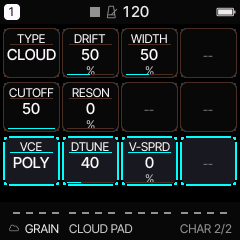 |
| ENV, row 1 | 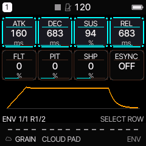 | 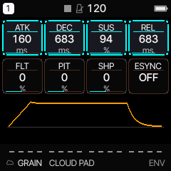 |
| ENV, row 2 | 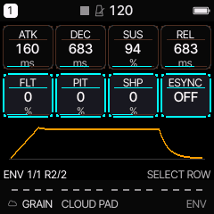 | 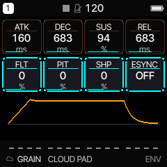 |

```sh
python3 tests/grid_hints_compare.py --base-tree /path/to/5bb8fcc --out /tmp/grid-hints
```

Requires the existing generated tables and pinned engine dependency. PPM/PNG
captures for all four tracks, raw frames and PCM are emitted under the output
directory. `GRID_HINTS_BASE_TREE` enables this comparison from
`tests/run_grain_only.sh`. Existing tests and goldens are not weakened or changed.

## Pixel and dirty-rectangle verification

**760455 assertions passed** in the fixed native capture/dirty-redraw fixture.
The exact-base fixture completes with 135 assertions. Both produce 140 frames
(16128000 RGB565 bytes per revision):

- All 32 grid frames differ only within x=0..239, y=188..199.
- Every pixel outside that strip is byte-identical, including all cells, row
  highlights, graph, coffee-bean sequencer and bottom labels.
- The strip is entirely black after the change. Across all 32 grid frames,
  26328 previously nonblack text pixels are removed.
- All 108 non-grid frames match byte-for-byte without any allowed region.
- All 64 requested grid captures are actual 240×240 frames (four tracks × eight
  states × two revisions); the 16 CH1 captures are included above.

Fresh-process four-track sequencer/mixer audio is **524288 bytes identical** to
the exact base. Both explicitly use nonzero master and verify sounding output:
peak 13962, RMS 1496.355513, 119774 nonzero stereo samples, sequencer step 11.
No comparison of silent buffers is accepted as audio equivalence.

The new fixture tests incremental edits of every populated cell on each row,
including changes that affect other labels/units. Each incremental frame must
match a forced full redraw. The cleared strip must remain entirely black after
edits, row/page and track changes and full redraws. It also deliberately paints
white into the old text region and verifies that a subsequent full redraw clears
it. No new border/separator is allowed: every pixel of the strip must be black.
Bounds hooks verify all blits stay inside 240×240.

## Regressions and sanitizers

| Suite | Passing assertions / result |
| --- | --- |
| New native grid capture/dirty-redraw fixture | 760455, zero failures |
| Existing ENV physical grid | 15936 |
| Existing ENV visual/value/bounds sweep | 3794 |
| Existing GRAIN grid navigation | 2329 |
| Existing GRAIN visual/value/bounds sweep | 1935 |
| Existing GRAIN theme/shared bean footer | 8229 |
| Full diagnostic UI/navigation | 850, zero failures |
| GRAIN-only policy / editor-storage / persistence | 380 / 70 / 24 |
| Four-part audio / CUTOFF-zero | 330 / 2355 |
| STRETCH descriptors | 1764 |
| Long EDIT integration | 108718, 1388 hold cases |
| Long EDIT timing fixture | 1920 |
| Editor / project / presets / backup | 172 / 61 / 45 / 103 |
| FUN11/FUN10 project format | 41146 |
| Exact-base audio | 524288 PCM bytes identical, verified nonzero |
| Whitespace / shell / Python syntax | Pass |

The existing CUTOFF fixture's eight type/transition audio runs and four STRETCH
audio render runs also complete successfully. No existing test assertions or
goldens were changed. Full legacy UI/backend and multi-engine navigation tests
run in diagnostic mode; shipping policy, new ENV, visual and audio tests run
with GRAIN-only policy. The timing fixture in this batch uses the same rendered
UI sanitizer flags described below.

Historical native MIDI failures remain **134 passing / 15 failing**, and motion
remains **97 passing / 27 failing**. Both were rerun on the exact base and fix;
failing assertion names match exactly. There are no new failures in this batch.

Rendered UI/DSP ASan+UBSan runs retain the repository's historical exclusions
for signed overflow, shift, bounds, object-size and pointer-overflow. ASan and
remaining UBSan checks remain enabled. No sanitizer checks or assertions were
removed for this change. No sanitizer diagnostics occur in the reported runs.
The full registered numerical DSP script and broad web suite were not rerun for
this five-line rendering deletion. Native emulator testing does not establish
new WASM/browser or hardware readiness.

## Native size / RAM

Identical GCC 14.2 `-Os -ffp-contract=off` compilation of
`web/emu/felucca_web.c`:

| Native section | Exact base | Fix | Delta |
| --- | ---: | ---: | ---: |
| text, including read-only constants | 879920 | 879629 | **−291 bytes** |
| data | 31060 | 31060 | 0 |
| BSS | 1603232 | 1603232 | 0 |

Persistent RAM, engine memory and existing framebuffer allocation are unchanged.
The native grid-renderer stack frame drops from 208 to 192 bytes (−16). These
individual host stack frames are not target worst-case stack measurements.
Full redraws also avoid the old 240×12 hint blit (2880 pixels). Incremental
parameter redraw work is unchanged.

These are full native emulator objects, not target linked firmware. No new
firmware assets, framebuffer, persistent state or dynamic allocation. The target
JieLi toolchain is unavailable; hardware flash fit remains unverified. No merge,
deployment or flashing.

## Changed files

- `firmware/src/grain_edit_grid.c`: remove only the grid status/hint drawing.
- `web/emu/grid_hints_test.c`: native capture, dirty-redraw and bounds fixture.
- `tests/grid_hints_compare.py`: exact-base pixel/audio comparisons and PNG export.
- `tests/run_grain_only.sh`: optional comparison registration.
- This report and 16 before/after native capture PNGs.
