# COFFEE GRAINS — SEQ visual theme

Base: `feat/coffee-grains-glo-theme`, `3e0b8f4512bca6cd1f4b5c2d9c25c9e50813b619`.
Implementation branch: `feat/coffee-grains-seq-theme`.

## Changes and invariants

This is a rendering-only change in the shipping GRAIN-only build. The existing three SEQ pages and separate SEQ TOOLS overlay remain separate, with their original controls, coordinates, navigation and data. Diagnostic multi-engine rendering retains its original presentation.

- Piano roll: reuse the existing rounded GLO parameter cards; track-colored selection frame and notes, subtle alternating pitch rows and coffee grid lines, gold playhead and accent notes. Note, rest, tie, slide and ratchet interpretation, pitch scrolling, piano labels and exact editing geometry remain unchanged. The original context-sensitive TIME/LEN label remains.
- Detail: rounded dark lane backgrounds, track-colored lane markers and values, coffee outlines, independent gold playhead. Existing scaling, probability conditions (including the original CHANCE/COND label change), ratchets, signed nudge and velocity formatting remain unchanged.
- Automation: rounded event rows, selected-track border, readable selected text and active/dim indicators. Original content, scrolling, event/lock indices, empty states, CLEAR confirmation, DELETE and BACK remain.
- Tools: rounded procedural action cells with warm borders, track-colored held states and a coral CLEAR border. DOUBLE/HALF and the existing secondary EUCLID display are themed in place. Existing held-key bits feed the render signature so released highlights redraw correctly. No input handler changes. CLEAR retains its existing immediate/undo behavior; no new confirmation is invented. Existing DRUM-only tools stay hidden under the unchanged GRAIN-only policy.

No DSP, input routing, timing, parameter, serialized data, assets or engine-selection code changed. No bitmap, framebuffer, allocation, timer or persistent animation state was added. Top status bars and bottom footers are preserved.

## Actual native captures

Each image is a lossless conversion of an actual 240×240 RGB565 emulator render, not a mockup. Left is exact base; right is this branch.

| State | Before | After |
|---|---|---|
| Piano roll | 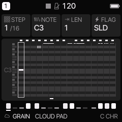 | 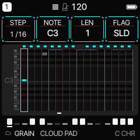 |
| Detail | 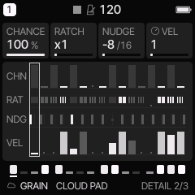 | 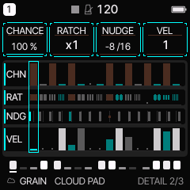 |
| Automation | 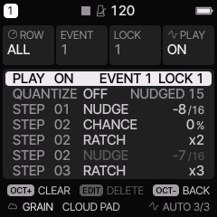 | 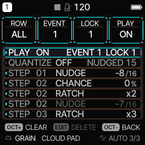 |
| Tools | 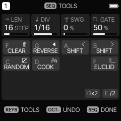 | 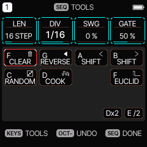 |
| Secondary Euclid | 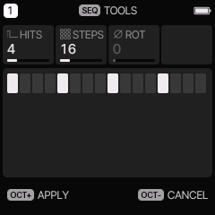 | 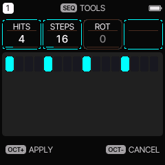 |
| Running piano | 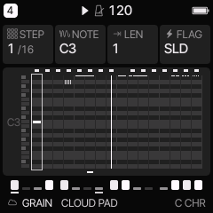 | 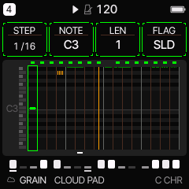 |
| Running detail | 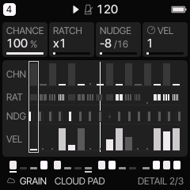 | 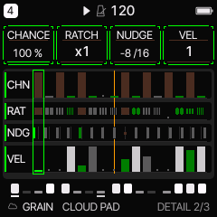 |
| Empty piano | 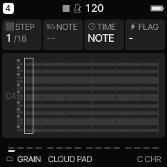 | 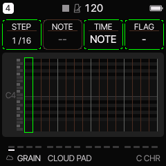 |
| Empty automation | 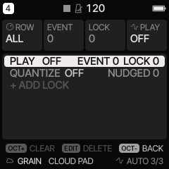 | 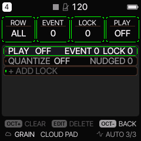 |

## Validation

New `tests/seq_theme_test.c` drives real button/encoder input on all four tracks, all 16 steps, mixed note/rest/tie patterns, detail edits, automation actions, tools, Euclid, playback, held-key parameter locks, recording, save/load and undo routes. Both exact base and new code pass **98 assertions** across **612 state checkpoints**. Captured sequencer/project/UI/parameter state is byte-identical: **3,596,112 bytes**. Render comparisons also preserve all **52** restored non-SEQ frames and the headers/footers of **560** SEQ trace frames. The test waits for the pre-existing layer cooldown before held-knob lock checks; production timing is unchanged.

New `web/emu/seq_visuals_test.c` passes **1,419 assertions**: native bounds, all tracks, all selected steps, running/stopped redraws, pitch scrolling, detail extremes and conditions, automation scrolling, held/released tools, and Euclid range. Incremental renders match forced full redraws. **96 unrelated frames (11,059,200 bytes) are pixel-identical**; **24** target captures change only the body, retaining exact status/footer pixels. Existing dim text styling is retained; no text or bounds safety assertions were deleted.

Fresh four-track audio comparison uses the existing `long_edit_test --audio 0` sounding fixture with nonzero master. **524,288 PCM bytes match the exact base**. Interpreted as signed 16-bit PCM: peak **13,962**, RMS **1,058.083289**, **208,052 nonzero samples**. No silent-buffer equivalence claim.

Existing regression results:

| Suite | Result |
|---|---|
| GRAIN-only policy / editor-storage / persistence | 380 / 70 / 24 passed |
| GRAIN four-part audio | 330 passed |
| CUTOFF-zero / cutoff audio | 2,355 passed / 8 sounding renders |
| GRAIN theme / grid visuals | 8,229 / 1,935 passed |
| Disabled long EDIT / timing | 98,670 (1,260 hold cases) / 1,920 passed |
| ENV grid / ENV visuals | 15,936 / 3,794 passed |
| STRETCH audio | 4 renders passed |
| Full diagnostic UI | 850 passed, 0 failed |
| Editor / project / presets / backup | 172 / 61 / 45 / 103 passed |
| FUN11/FUN10 project format | 41,146 passed |
| STRETCH descriptors / GRAIN grid | 1,764 / 2,329 passed |
| MIDI | 134 passed, 15 historical failures |
| Motion | 97 passed, 27 historical failures |

MIDI and motion were rerun against this exact base; failure lines match exactly. They remain failures, not green suites. Diagnostic UI/editor/storage suites use `FELUCCA_GRAIN_ONLY=0`; shipping policy/navigation/render tests use the shipping build. No existing assertions or unrelated goldens changed.

ASan/UBSan runs reported no new diagnostics. Existing rendered-UI/DSP exclusions were retained: signed-integer-overflow, shift, bounds, object-size and pointer-overflow; this is **not** a claim of fully strict numerical DSP sanitization. The new work introduces no sanitizer exclusions. Broad web and full DSP numerical matrices were not rerun for this rendering-only change.

Reproduce exact-base render/state/audio comparisons (with generated tables already available):

```sh
python3 tests/seq_theme_compare.py --base-tree /path/to/exact-base-worktree --out /tmp/seq-theme-comparison
```

`tests/run_grain_only.sh` includes the new interaction test and supports optional `SEQ_THEME_BASE_TREE` comparison. Capture tests and comparison script generate outputs outside tracked source files.

## Resources and limitations

Host `cc -Os -ffp-contract=off` native object comparison:

| Section | Base bytes | New bytes | Delta |
|---|---:|---:|---:|
| text | 884745 | 885503 | +758 |
| data | 31060 | 31060 | 0 |
| BSS | 1603232 | 1603232 | 0 |

No persistent RAM or firmware bitmap cost. Compiler stack-usage reports: `draw_column` 304 unchanged, `graph_events` 976 unchanged, `lcell` 104 unchanged; new render-only held-mask helper 40 bytes; `pr_split` 64→72 bytes. `draw_graph` changes 1064→312 bytes because inlining decisions changed (not a claim of equivalent whole-call-chain reduction). No audio stack work added. These are host compiler figures, not target ABI measurements.

Emscripten is unavailable in this environment, so no new WASM build was performed. Native emulator capture and bounds tests passed. No successful target link was available: **hardware flash fit, CPU timing and target stack remain unverified** against the 581,564-byte image limit. Host text delta is not target flash headroom. No merge, deployment or hardware flashing performed.

## Changed files

Rendering: `firmware/src/ui_draw.c`, `firmware/src/ui_graph.c`, `firmware/src/ui_layer.c`.
Tests: `tests/seq_theme_test.c`, `tests/seq_theme_compare.py`, `web/emu/seq_visuals_test.c`, `tests/run_grain_only.sh`.
Documentation: this report and 18 native before/after PNG captures under `docs/images/seq-theme/`.
